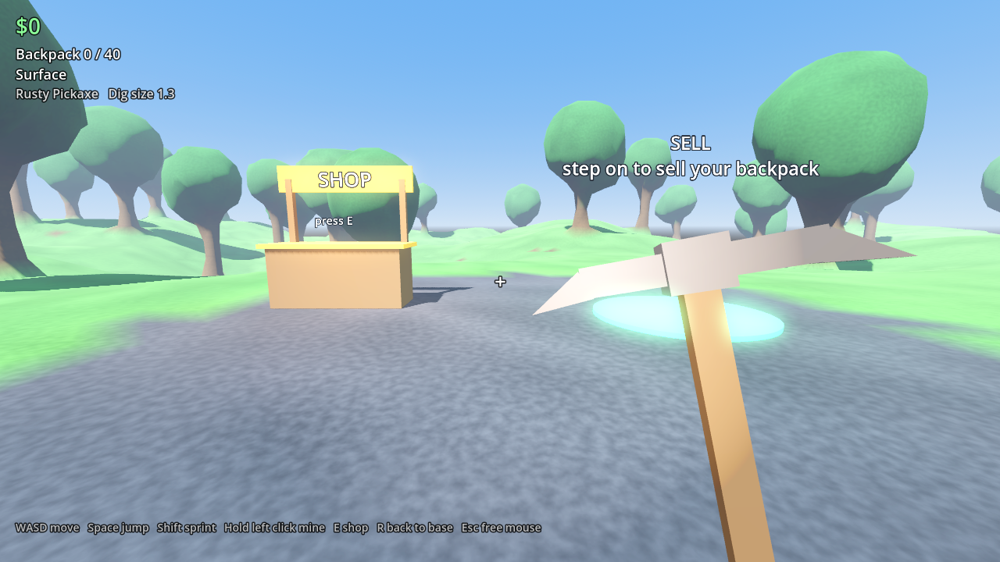
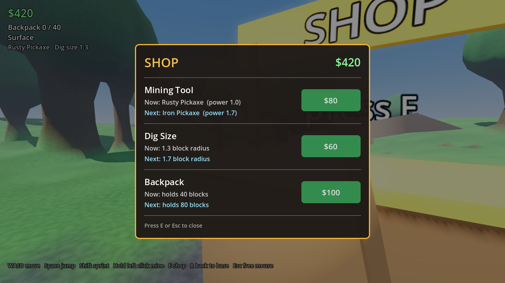

# Planet Killer

An incremental voxel mining game. You start on the surface with a pickaxe and a
backpack. Every block can be mined, deeper layers pay more, and the long-term goal
is to strip the whole planet down to its core.



| Digging into the layers | The shop |
| --- | --- |
|  |  |

## Play it

1. Install **Godot 4.3** or newer 4.x (the standard build, not .NET): https://godotengine.org/download
2. Open Godot, click **Import**, and pick the `project.godot` file in this folder.
3. Press **F5** (or the ▶ button at the top right) to play.

The first open takes a few seconds while Godot imports the project.
If your computer's graphics are old and the game won't start, go to
**Project > Project Settings > Rendering > Renderer** and switch to *Compatibility*.

### Controls

| Key | Action |
| --- | --- |
| W A S D | Move |
| Mouse | Look |
| Space | Jump |
| Shift | Sprint |
| Hold left click | Swing your tool. Each dig scoops a round chunk out of the ground |
| E | Open the shop (stand at the counter) |
| R | Teleport back to base |
| Esc | Free the mouse (click to grab it again) |

### The loop

Dig to fill your backpack (40 blocks to start). The glowing bubble shows how big a chunk
your next dig takes out. Harder materials need more hits before the chunk comes out.
When your backpack is full, go back to the green **SELL** pad at the base (press R to
teleport there) and step on it to sell everything. Then spend your money at the **SHOP**:

| Upgrade | Levels |
| --- | --- |
| Mining tool | Rusty, Iron and Steel Pickaxe, then Hand Drill and Power Drill |
| Dig size | Radius 1.3, 1.7, 2.2, 2.8, 3.5 blocks |
| Backpack | 40, 80, 160, 320, 640 blocks |

| Layer | Found | Value per block |
| --- | --- | --- |
| Grass, leaves | Surface | $0 (not kept) |
| Dirt | Top 4 blocks | $1 |
| Wood | Trees | $2 |
| Stone | Down to 28m | $4 |
| Basalt | Below 28m, harder | $6 |
| Coal | 3m to 40m | $8 |
| Iron | 10m and deeper | $15 |
| Gold | 24m and deeper | $30 |
| Sapphire | 36m and deeper | $60 |
| Ruby | 46m and deeper | $100 |
| Core | Bottom of the world | Unbreakable (for now) |

## Tuning the game

Most numbers live in two files, so you can change them without touching game code:

- `scripts/data/blocks.gd`: every material's name, sell value, hardness and color.
- `scripts/data/upgrades.gd`: shop prices and what each tool, dig size and backpack level gives you.
- `scripts/data/world_config.gd`: world size, seed, hill height, layer depths, which ores appear at which depths and how rare they are.
- `scripts/game_state.gd`: money, backpack and upgrade levels, plus how far you can reach.

## How it's built

- `scripts/voxel_world.gd` stores a density and a material for every grid point and draws the
  surface with *surface nets*, which gives smooth, rounded terrain instead of cubes. It is split
  into 16×16×16 chunks, and a dig rebuilds only the chunks it touched.
- `scripts/player.gd` is the first-person miner: movement, the tool models, swing and drill
  animations, camera bob and shake, and digging.
- `scripts/shop.gd` is the shop counter and menu, `scripts/sell_pad.gd` the sell zone,
  `scripts/hud.gd` the on-screen text, `scripts/main.gd` builds the scene.

Everything is plain GDScript with no plugins, so the project opens in a stock Godot install.
The world is 96×80×96 blocks for now. Going much bigger (a real planet with caves) will
mean moving the terrain to the Voxel Tools engine module or threaded chunk loading, which
is planned for a later step.

## Tests

A headless smoke test generates the world, checks every layer and ore exists, mines a
column of blocks, sells them and checks the money:

```
godot --headless --path . -s res://tests/smoke_test.gd
```

`tests/screenshot.gd` saves screenshots without a person at the keyboard (needs a display or `xvfb-run`).

## Roadmap

1. **Core loop:** walk, dig smooth terrain, fill the backpack, sell at base. Done.
2. **Economy:** shop for tool, dig size and backpack upgrades. Started; values still need tuning.
3. **Underground:** caves, monsters, weapons.
4. **Base building:** place blocks, base upgrades.
5. **Vehicles:** drill tank, then a ship for carving big chunks.
6. **Automation:** mining robots and factories.
